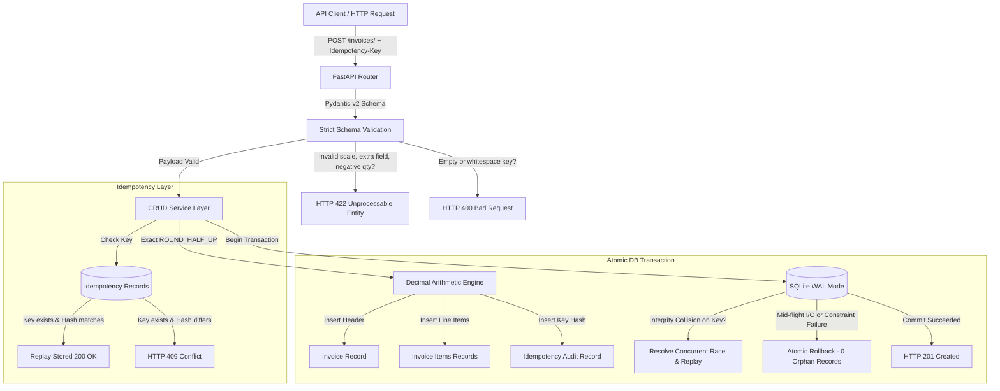

# Backend Invoice Management API — Testing and Reliability Project

[](https://github.com/udaykarra/invoice-management-api/actions)


A portfolio project demonstrating backend API design, financial calculation correctness, automated testing, concurrent idempotency safety, and deterministic contract verification.

Built with **Python**, **FastAPI**, **SQLAlchemy**, and **SQLite (WAL mode)**. Includes an automated contract verifier and a multi-candidate evaluation benchmark (`tasks/invoice_total/`) designed for AI code evaluation platforms.

---

## Table of Contents

- [System Architecture](#system-architecture)
- [Directory Structure](#directory-structure)
- [Quickstart & Setup](#quickstart--setup)
- [API Reference & Examples](#api-reference--examples)
- [Core Engineering Concepts](#core-engineering-concepts)
  - [1. Arbitrary-Precision Decimal Arithmetic](#1-arbitrary-precision-decimal-arithmetic)
  - [2. Concurrent Idempotency & Race Handling](#2-concurrent-idempotency--race-handling)
  - [3. Transactional Consistency & Rollbacks](#3-transactional-consistency--rollbacks)
  - [4. Strict Validation Constraints](#4-strict-validation-constraints)
- [Evaluation Benchmark: Candidate Solution Verifier (`tasks/`)](#evaluation-benchmark-candidate-solution-verifier-tasks)
- [Illustrative Debugging Case Study: The "Disappearing Penny"](#illustrative-debugging-case-study-the-disappearing-penny)
- [Verification & Automated Tests](#verification--automated-tests)

---

## System Architecture



---

## Directory Structure

```text
.
├── .github/
│   └── workflows/
│       └── python-app.yml       # GitHub Actions CI matrix (Py 3.10, 3.11, 3.12)
├── app/
│   ├── __init__.py             # Package initializer
│   ├── config.py               # Pydantic Settings & environment config
│   ├── crud.py                 # Financial arithmetic, concurrent idempotency, transactions
│   ├── database.py             # SQLAlchemy engine, WAL journal mode & session lifecycle
│   ├── errors.py               # Standardized exception hierarchy & uniform JSON envelope
│   ├── main.py                 # FastAPI routing, lifecycle, and endpoint handlers
│   ├── models.py               # ORM models (Invoice, InvoiceItem, IdempotencyRecord)
│   └── schemas.py              # Pydantic v2 schemas (strict scale validation, extra='forbid')
├── tasks/                      # Candidate solution evaluation benchmark
│   └── invoice_total/
│       ├── README.md           # Problem statement & acceptance criteria
│       ├── contract.py         # Formal dataclass interface & type signature
│       ├── reference.py        # Official reference implementation
│       ├── test_cases.py       # Deterministic valid & adversarial test dataset
│       ├── verifier.py         # Multi-candidate solution test harness
│       └── solutions/          # Valid and deliberately flawed candidate implementations
├── tests/
│   ├── __init__.py
│   ├── conftest.py             # Pytest fixtures & isolated WAL test database
│   └── test_invoices.py        # 26 automated unit, integration, concurrency & negative tests
├── .gitignore                  # Git exclusions
├── requirements.txt            # Project dependencies
├── verifier.py                 # Master contract verifier (runs API contracts & task benchmark)
└── README.md                   # Technical documentation & case study
```

---

## Quickstart & Setup

### 1. Prerequisites
- Python 3.10, 3.11, or 3.12
- Git

### 2. Setup Virtual Environment

#### On Windows (PowerShell):
```powershell
# Clone the repository
git clone https://github.com/udaykarra/invoice-management-api.git
cd invoice-management-api

# Create virtual environment
python -m venv .venv

# Activate virtual environment
.\.venv\Scripts\Activate.ps1

# Install dependencies
pip install -r requirements.txt
```
*(If PowerShell restricts script execution, run `Set-ExecutionPolicy -ExecutionPolicy RemoteSigned -Scope Process` first).*

#### On Linux / macOS:
```bash
git clone https://github.com/udaykarra/invoice-management-api.git
cd invoice-management-api

python3 -m venv .venv
source .venv/bin/activate
pip install -r requirements.txt
```

### 3. Run the Development Server
```bash
uvicorn app.main:app --reload --port 8000
```
- Interactive Swagger UI: [http://localhost:8000/docs](http://localhost:8000/docs)
- Interactive ReDoc: [http://localhost:8000/redoc](http://localhost:8000/redoc)
- System Health: [http://localhost:8000/health](http://localhost:8000/health)

### 4. Run the Pytest Test Suite
```bash
pytest -v
```

### 5. Run the Deterministic Verifier & Benchmark
```bash
python verifier.py
```

---

## API Reference & Examples

All error responses strictly adhere to a standardized machine-readable envelope:
```json
{
  "error": {
    "code": "ERROR_CODE",
    "message": "Human readable explanation",
    "details": null
  }
}
```

### 1. Create Invoice (with Idempotency Key)
```bash
curl -X POST "http://localhost:8000/invoices/" \
  -H "Content-Type: application/json" \
  -H "Idempotency-Key: req_live_948210" \
  -d '{
    "customer_name": "Acme Technologies",
    "customer_email": "billing@acme.com",
    "currency": "USD",
    "tax_rate": "0.0825",
    "notes": "Net 30 payment terms",
    "items": [
      {
        "description": "Cloud Hosting Server",
        "quantity": 1,
        "unit_price": "299.00"
      },
      {
        "description": "Domain Registration",
        "quantity": 2,
        "unit_price": "14.50"
      }
    ]
  }'
```

**Response (HTTP 201 Created on first request, HTTP 200 OK on identical replay):**
```json
{
  "id": "inv_8b95f70239aa",
  "customer_name": "Acme Technologies",
  "customer_email": "billing@acme.com",
  "status": "ISSUED",
  "currency": "USD",
  "tax_rate": "0.0825",
  "subtotal": "328.00",
  "tax_amount": "27.06",
  "total_amount": "355.06",
  "notes": "Net 30 payment terms",
  "created_at": "2026-10-22T07:15:00.123456",
  "updated_at": "2026-10-22T07:15:00.123456",
  "items": [
    {
      "id": 1,
      "description": "Cloud Hosting Server",
      "quantity": 1,
      "unit_price": "299.00",
      "line_total": "299.00"
    },
    {
      "id": 2,
      "description": "Domain Registration",
      "quantity": 2,
      "unit_price": "14.50",
      "line_total": "29.00"
    }
  ]
}
```

### 2. List Invoices (with Pagination & Status Filter)
```bash
curl -X GET "http://localhost:8000/invoices/?skip=0&limit=10&status=ISSUED"
```

### 3. Retrieve Single Invoice by ID
```bash
curl -X GET "http://localhost:8000/invoices/inv_8b95f70239aa"
```

### 4. Lifecycle Status Transitions
- **Mark Paid:** `POST /invoices/{id}/pay` (Transition to `PAID`. Cannot pay cancelled invoices: returns `409 Conflict`).
- **Cancel:** `POST /invoices/{id}/cancel` (Transition to `CANCELLED`. Cannot cancel paid invoices: returns `409 Conflict`).

---

## Core Engineering Concepts

### 1. Arbitrary-Precision Decimal Arithmetic
Binary floating-point arithmetic (IEEE 754) cannot represent base-10 fractional quantities like `0.10` exactly, leading to compounding roundoff errors. 

In this project:
- All monetary attributes (`unit_price`, `line_total`, `subtotal`, `tax_rate`, `tax_amount`, `total_amount`) are explicitly typed as Python `decimal.Decimal` and stored in SQLite using `Numeric(12, 2, asdecimal=True)`.
- Financial totals are rounded using commercial standard **`ROUND_HALF_UP`** (`Decimal("0.01")`). Unlike Python's default round-to-even (Banker's rounding), half-cent amounts $\ge 0.005$ always round upwards to the nearest cent, satisfying standard commercial accounting requirements.

### 2. Concurrent Idempotency & Race Handling
In high-throughput environments, multiple concurrent requests can arrive with the same `Idempotency-Key` (e.g. rapid automated retries):
1. **Primary Key Guarantee:** The `idempotency_records` table enforces a primary key on the `key` column.
2. **Race Resolution:** If two concurrent requests arrive simultaneously and both pass the initial `SELECT` check, one will commit while the second encounters a database `IntegrityError` (unique constraint collision).
3. **Graceful Replay:** The service catches `IntegrityError`, rolls back the uncommitted duplicate invoice, queries the winner's committed record, and returns the cached invoice with `HTTP 200 OK` and `X-Idempotent-Replay: true`. If the payload differed, it immediately returns `HTTP 409 Conflict`.
4. **Validation:** Idempotency keys that are empty or whitespace-only (`"   "`) are rejected with `HTTP 400 Bad Request`.

### 3. Transactional Consistency & Rollbacks
- Multi-table operations (creating an invoice, creating $N$ line items, and recording the idempotency audit record) are executed inside an atomic session block.
- Foreign keys are enforced in SQLite via connection event listeners (`PRAGMA foreign_keys=ON;`).
- SQLite WAL mode (`PRAGMA journal_mode=WAL;`) and a busy timeout of 30 seconds are configured to prevent locking errors during concurrent transactions.
- If any line item or database operation fails mid-flight, an immediate `db.rollback()` executes, guaranteeing that no orphan invoice headers are left in the database.

### 4. Strict Validation Constraints
Configured via Pydantic v2:
- `extra="forbid"`: Prevents mass-assignment vulnerabilities by rejecting payloads with unrecognized keys (`HTTP 422`).
- Line item `quantity` must be strictly positive (`gt=0`).
- Line item `unit_price` enforces a scale constraint of at most 2 decimal places (`unit_price <= 2 decimal places`), rejecting values like `10.999` with `HTTP 422`.
- `tax_rate` is constrained to the range `[0.00, 1.00]`.

---

## Evaluation Benchmark: Candidate Solution Verifier (`tasks/`)

Designed for AI coding benchmark systems (e.g., Micro1 evaluation harnesses), the directory [tasks/invoice_total/](file:///u:/New/tasks/invoice_total/) implements an isolated evaluation benchmark:

```text
tasks/invoice_total/
├── README.md                   # Problem statement & acceptance criteria
├── contract.py                 # Typed interface / contract definition
├── reference.py                # Reference implementation
├── test_cases.py               # Deterministic valid & adversarial test dataset
├── verifier.py                 # Multi-candidate evaluation harness
└── solutions/
    ├── candidate_valid_iterative.py    # Correct Solution A: Iterative accumulator
    ├── candidate_valid_functional.py   # Correct Solution B: Functional map-reduce
    ├── candidate_invalid_float.py      # Flawed 1: Uses float (precision drift)
    ├── candidate_invalid_bankers.py    # Flawed 2: Uses Banker's rounding
    ├── candidate_invalid_unscaled.py   # Flawed 3: Omits scale constraint check
    └── candidate_invalid_negative.py   # Flawed 4: Omits negative quantity check
```

When [tasks/invoice_total/verifier.py](file:///u:/New/tasks/invoice_total/verifier.py) runs, it tests candidate implementations against the test cases, verifying that:
- **Multiple distinct correct implementations** (procedural iterative and functional map-reduce) both pass all acceptance criteria.
- **Flawed implementations** are rejected with descriptive diagnostic failure messages corresponding to their specific defects.

Run the benchmark directly:
```bash
python tasks/invoice_total/verifier.py
```

---

## Illustrative Debugging Case Study: The "Disappearing Penny"

> **Note:** This case study is an illustrative technical deep-dive demonstrating how floating-point currency defects and Banker's rounding anomalies manifest in financial systems, how they are root-caused, and how they are resolved through decimal arithmetic and regression testing.

### 1. Defect Description
A billing calculation engine using native floating-point arithmetic reported inconsistencies when calculating line item totals and sales tax:
- Calculating 3 items at \$100.10, 7 items at \$0.20, and 100 items at \$0.05 produced an internal subtotal of `306.69999999999993` instead of `306.70`.
- Applying a sales tax rate of 0.45% on a \$10.00 subtotal resulted in `10.00 * 0.0045 = 0.045`. Using Python's native `round(0.045, 2)` rounded **down to 0.04** instead of up to 0.05.

### 2. Root Cause Analysis
1. **IEEE 754 Representation:** Binary floats cannot represent base-10 numbers with non-terminating binary fractions (e.g. `0.10`). Accumulating floating-point products across multiple items causes precision drift that impacts fractional cents.
2. **Banker's Rounding (Round to Even):** Python's built-in `round()` function implements IEEE 754 round-to-even behavior (Banker's rounding). For fractional cents where the remaining digit is 5, it rounds to the nearest even number (`round(0.045, 2) == 0.04`). Commercial invoicing rules, however, mandate `ROUND_HALF_UP` where `.005` always rounds up to `.01`.

### 3. Resolution & Regression Test
The arithmetic was migrated to `decimal.Decimal` with explicit `ROUND_HALF_UP`:
```python
TWO_PLACES = Decimal("0.01")

def round_currency(value: Decimal) -> Decimal:
    return value.quantize(TWO_PLACES, rounding=ROUND_HALF_UP)
```
A targeted regression test was added to [tests/test_invoices.py](file:///u:/New/tests/test_invoices.py):
```python
def test_rounding_half_up_behavior(client):
    payload = {
        "customer_name": "Rounding Test",
        "customer_email": "tax@test.com",
        "tax_rate": "0.1245",
        "items": [{"description": "Item", "quantity": 1, "unit_price": "10.00"}],
    }
    response = client.post("/invoices/", json=payload)
    assert response.status_code == 201
    assert Decimal(str(response.json()["tax_amount"])) == Decimal("1.25")
```

---

## Verification & Automated Tests

### 1. Pytest Test Suite (26 Tests)
Includes unit calculations, lifecycle state transitions, adversarial SQL injection attempts, malformed JSON inputs, decimal scale enforcement, whitespace idempotency rejection, and concurrent request handling:
```bash
pytest -v
```

### 2. Standalone Contract Verifier (13 API Contracts + 7 Benchmark Tests)
Bootstraps the FastAPI application and verifies HTTP status contracts, exact decimal math, idempotency invariants, atomic rollbacks, and candidate solution evaluations without external test runners:
```bash
python verifier.py
```

---

## License

This project is licensed under the MIT License.
