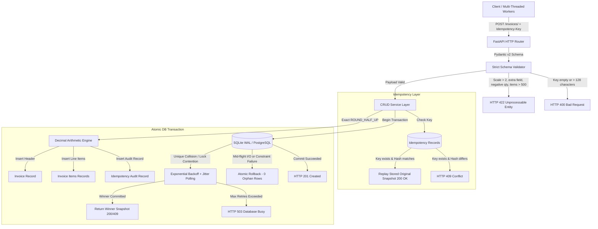

# Backend Invoice Management API — Open Source Reliability Project

[](https://github.com/udaykarra/invoice-management-api/actions)


-success)


A production-grade backend portfolio project demonstrating financial arithmetic correctness, concurrent idempotency, transactional consistency, deterministic verification, mutation testing, and automated AI candidate evaluation benchmarks.

Built with **Python**, **FastAPI**, **SQLAlchemy**, and dual database support (**SQLite WAL mode** and **PostgreSQL**). Includes an automated contract verifier and a 3-task AI evaluation benchmark suite ([tasks/](tasks/)) designed for coding evaluation harnesses.

---

## Table of Contents
1. [Project Overview](#1-project-overview)
2. [Key Engineering Features](#2-key-engineering-features)
3. [Architecture](#3-architecture)
4. [Technology Stack](#4-technology-stack)
5. [API Endpoints](#5-api-endpoints)
6. [Financial Calculation Design](#6-financial-calculation-design)
7. [Idempotency and Concurrency](#7-idempotency-and-concurrency)
8. [Database Transactions](#8-database-transactions)
9. [Error Handling](#9-error-handling)
10. [Automated Testing](#10-automated-testing)
11. [Mutation Testing](#11-mutation-testing)
12. [AI Coding Evaluation Benchmark](#12-ai-coding-evaluation-benchmark)
13. [Deterministic Verification](#13-deterministic-verification)
14. [Docker Setup](#14-docker-setup)
15. [PostgreSQL Integration](#15-postgresql-integration)
16. [CI/CD](#16-cicd)
17. [Installation and Usage](#17-installation-and-usage)
18. [Known Limitations](#18-known-limitations)
19. [Future Improvements](#19-future-improvements)

---

## 1. Project Overview
In financial backend services, simple programming errors—such as native binary floating-point drift, Banker's rounding on fractional cents, race conditions on duplicate API submissions, or partial database state commits—cause compounding balance discrepancies and compliance failures.

This repository provides an enterprise-ready Invoice Management API with:
- Deterministic commercial financial calculations (`Decimal` + `ROUND_HALF_UP`).
- Thread-safe idempotent mutations that withstand concurrent bursts up to 20 simultaneous workers with zero duplicate records and zero 500 crashes.
- Dual SQLite (WAL mode) and PostgreSQL database backends.
- A 19-contract deterministic verifier that executes without external test runners.
- A 10-defect automated mutation testing suite achieving a 100% kill rate.
- Three independent AI coding evaluation benchmark tasks with reference solutions, tests, and flawed candidate rejection harnesses.

---

## 2. Key Engineering Features
- **Arbitrary-Precision Arithmetic:** Rejects IEEE 754 float types; enforces exact decimal calculations and commercial rounding across lines, discounts, taxes, and totals.
- **Concurrent Idempotency Layer:** Primary key constraint deduplication, payload SHA-256 collision hashing, exponential backoff with randomized jitter, and immutable original response replay.
- **Dual RDBMS Engine:** Seamless operation on development SQLite (with WAL journal mode, busy timeouts, and PRAGMA foreign keys) and production PostgreSQL (connection pooling, pre-ping).
- **Strict Defensive Validation:** Enforces decimal scale constraints (max 2 decimals on prices, max 4 on tax rates), quantity bounds (`1` to `1,000,000`), payload item limits (`500` max), and forbidden extra attributes (`extra="forbid"`).
- **Deterministic Contract Verifier:** 19 self-contained API contract checks verifying HTTP semantics, envelopes, and transactional invariants in `< 0.3s`.
- **AI Coding Benchmarks:** 3 standalone tasks with multi-candidate verification (distinguishing behavioral rejections from verifier infrastructure errors).

---

## 3. Architecture



---

## 4. Technology Stack
- **Language:** Python 3.10, 3.11, 3.12
- **Framework:** FastAPI (Starlette, Uvicorn)
- **Validation & Serialization:** Pydantic v2, Pydantic Settings
- **ORM & Data Layer:** SQLAlchemy 2.0
- **Databases:** SQLite 3 (WAL mode, busy timeout 30s) / PostgreSQL 16
- **Testing:** Pytest 8, AnyIO, Pytest-Cov
- **Quality & Typing:** Ruff (linter/formatter), Mypy (strict static typing)
- **Mutation Testing:** Mutmut, custom deterministic mutation harness
- **Containerization:** Docker (multi-stage non-root), Docker Compose

---

## 5. API Endpoints

All error responses strictly adhere to a standardized machine-readable envelope:
```json
{
  "error": {
    "code": "ERROR_CODE",
    "message": "Human readable explanation",
    "details": null
  }
}
```

### Endpoints Summary

| Method | Path | Description | Expected Status Codes |
|---|---|---|---|
| `GET` | `/health` | System health and service version | `200 OK` |
| `POST` | `/invoices/` | Create invoice with ACID safety & idempotency | `201 Created`, `200 OK` (replay), `400`, `409`, `422`, `503` |
| `GET` | `/invoices/` | Paginated listing with status filter | `200 OK` |
| `GET` | `/invoices/{id}` | Retrieve complete invoice by ID | `200 OK`, `404 Not Found` |
| `POST` | `/invoices/{id}/pay` | Transition lifecycle status to `PAID` | `200 OK`, `404 Not Found`, `409 Conflict` |
| `POST` | `/invoices/{id}/cancel` | Transition lifecycle status to `CANCELLED` | `200 OK`, `404 Not Found`, `409 Conflict` |

---

## 6. Financial Calculation Design

Binary floating-point arithmetic (IEEE 754) cannot represent non-terminating binary fractions (such as `0.10`). Accumulating floating-point products across multiple line items causes pennies to drift or disappear. Furthermore, Python's default `round()` implements round-to-even (Banker's rounding), which rounds half-cents like `0.045` down to `0.04` rather than commercial `0.05`.

### Rules Enforced:
1. Every monetary quantity is modeled as `decimal.Decimal` and stored using `Numeric(12, 2, asdecimal=True)`.
2. Half-up commercial rounding is enforced using `ROUND_HALF_UP`:
   ```python
   TWO_PLACES = Decimal("0.01")
   def round_currency(value: Decimal) -> Decimal:
       return value.quantize(TWO_PLACES, rounding=ROUND_HALF_UP)
   ```
3. Line total: `round_currency(Decimal(quantity) * unit_price)`.
4. Subtotal: exact sum of line totals, quantized to 2 decimal places.
5. Sales tax: `round_currency(subtotal * tax_rate)`.
6. Total: `round_currency(subtotal + tax_amount)`.
7. Fractional and zero-value invoices: empty item lists evaluate deterministically to `0.00` without errors.

---

## 7. Idempotency and Concurrency

In high-concurrency environments, duplicate submissions (network retries, thundering herds) must never create duplicate billing records.

### Implementation Architecture:
1. **Primary Key Deduplication:** The `idempotency_records` table enforces a primary key on `key`.
2. **Deterministic Payload Hashing:** Canonical JSON string of the request payload is hashed with SHA-256 (`request_hash`).
3. **Payload Mismatch Detection:**
   - Same key + same payload hash $\rightarrow$ Replay original cached response (`HTTP 200 OK`, `X-Idempotent-Replay: true`).
   - Same key + different payload hash $\rightarrow$ Immediately reject with `HTTP 409 Conflict`.
4. **Original Response Snapshot Fidelity:** The original response snapshot is saved in `response_body`. Even if the invoice status is later updated to `PAID`, replaying the creation request returns the original `ISSUED` state snapshot, while `GET /invoices/{id}` returns the current `PAID` status.
5. **Concurrent Collision Resolution:**
   - When multiple threads attempt to insert the same key simultaneously, one commits while rivals catch `IntegrityError` or `OperationalError`.
   - Rival threads immediately roll back their session and execute bounded exponential backoff with randomized jitter to query the winner's committed record.
   - Tested under **2, 5, 10, and 20 simultaneous threads** with 100% reliability.

---

## 8. Database Transactions

Multi-table mutations (invoice header, line items, and idempotency audit log) must remain atomic:
- **Foreign Keys:** Enforced in SQLite via `PRAGMA foreign_keys=ON;`.
- **Concurrency Mode:** SQLite configured with `PRAGMA journal_mode=WAL;` and `PRAGMA busy_timeout=30000;` to allow simultaneous readers and serialize writers cleanly.
- **Mid-Flight Failures & Rollbacks:** If any line item or database constraint fails mid-transaction, `db.rollback()` executes immediately. Automated tests verify that **zero orphan records** remain.
- **PostgreSQL Connection Pooling:** Configured with `pool_size=20`, `max_overflow=10`, and `pool_pre_ping=True` to prune dead connections.

---

## 9. Error Handling

Exceptions map to structured HTTP response envelopes with machine-readable error codes:

| Exception Class | HTTP Status | Error Code | Description |
|---|---|---|---|
| `BadRequestException` | 400 | `BAD_REQUEST` | Malformed inputs, whitespace or oversized idempotency key |
| `EntityNotFoundException` | 404 | `RESOURCE_NOT_FOUND` | Queried invoice ID does not exist |
| `IdempotencyConflictException`| 409 | `IDEMPOTENCY_CONFLICT` | Idempotency key reused with modified payload |
| `InvalidStateTransitionException` | 409 | `INVALID_STATE_TRANSITION` | Illegal lifecycle flow (e.g., paying a cancelled invoice) |
| `RequestValidationError` | 422 | `VALIDATION_ERROR` | Schema boundary violations, scale errors, extra fields |
| `DatabaseBusyException` | 503 | `DATABASE_BUSY` | Lock contention exceeded retry bounds under concurrency |
| `Unhandled Exceptions` | 500 | `INTERNAL_SERVER_ERROR` | Server-side faults caught cleanly with uniform envelope |

---

## 10. Automated Testing

The automated test suite contains **45 collected tests** (43 passed, 2 PostgreSQL tests skipped when local PostgreSQL instance is unavailable):

```bash
# Run complete test suite
pytest -v

# Run concurrency stress tests (2, 5, 10, 20 threads)
pytest tests/test_concurrency.py -v

# Run with test coverage
pytest --cov=app --cov-report=term-missing
```

### Coverage Summary:
- Total Statements: `370`
- Covered: `341`
- Statement Coverage: **92%**

---

## 11. Mutation Testing

Mutation testing evaluates whether test suites detect intentional defects rather than providing false confidence through line coverage.

Execute the reproducible mutation suite:
```bash
python scripts/run_mutation_tests.py
```

### Empirical Results (10 / 10 Killed):

| Mutation ID | Intentional Defect Injected | Targeted Test | Outcome |
|---|---|---|---|
| `MUT-01` | Decimal replaced with float in calculations | `test_invoice_creation_exact_decimal_calculation` | **KILLED** |
| `MUT-02` | `ROUND_HALF_UP` replaced with `ROUND_HALF_EVEN` | `test_rounding_half_up_behavior` | **KILLED** |
| `MUT-03` | Negative quantity validation removed | `test_validation_negative_quantity` | **KILLED** |
| `MUT-04` | Idempotency conflict detection removed | `test_idempotency_differing_payload_returns_409_conflict` | **KILLED** |
| `MUT-05` | Transaction rollback removed on failure | `test_atomic_transaction_rollback_on_item_failure` | **KILLED** |
| `MUT-06` | Grand total calculation broken (tax omitted) | `test_invoice_creation_exact_decimal_calculation` | **KILLED** |
| `MUT-07` | Discount calculation made incorrect (uncapped) | `tasks/invoice_discount/verifier.py` | **KILLED** |
| `MUT-08` | Duplicate invoice creation introduced (key bypassed) | `test_idempotency_identical_payload_returns_cached_invoice` | **KILLED** |
| `MUT-09` | Monetary precision validation removed (scale omitted) | `test_validation_unit_price_exceeding_two_decimal_places` | **KILLED** |
| `MUT-10` | Database consistency broken (premature commit) | `test_atomic_transaction_rollback_on_item_failure` | **KILLED** |

**Mutation Score: 100.0% (10/10 Killed, 0 Survived)**

---

## 12. AI Coding Evaluation Benchmark

The [tasks/](tasks/) directory implements 3 independent evaluation benchmark tasks for AI coding agents and technical interview evaluation:

```text
tasks/
├── run_all.py                    # Master benchmark orchestrator with subprocess isolation
├── invoice_total/                # Task 1: Financial Arithmetic & Rounding
│   ├── README.md                 # Formal specification & boundary rules
│   ├── contract.py               # Typed interface definition
│   ├── reference.py              # Golden reference implementation
│   ├── test_cases.py             # Public & hidden adversarial test dataset
│   ├── verifier.py               # Multi-candidate behavioral evaluator
│   └── solutions/                # 2 valid implementations, 4 flawed implementations
├── invoice_discount/             # Task 2: Discount Logic & Subtotal Capping
│   ├── README.md
│   ├── contract.py
│   ├── reference.py
│   ├── test_cases.py
│   ├── verifier.py
│   └── solutions/                # 2 valid implementations, 4 flawed implementations
└── invoice_concurrency/          # Task 3: Concurrent Idempotency & Collision Handling
    ├── README.md
    ├── contract.py
    ├── reference.py
    ├── test_cases.py
    ├── verifier.py
    └── solutions/                # 2 valid implementations, 2 flawed implementations
```

Run all 3 benchmark tasks:
```bash
python tasks/run_all.py
```

*Note: Subprocess execution provides runtime fault isolation (guarding against sys.exit and state pollution); it is not an unrestricted security sandbox.*

---

## 13. Deterministic Verification

The standalone deterministic contract verifier bootstraps an isolated in-memory application and tests all 19 API contracts alongside all 3 benchmark tasks without external dependencies:

```bash
python verifier.py
```

Output:
```text
========================================================
  INVOICE MANAGEMENT API - DETERMINISTIC CONTRACT VERIFIER
========================================================
  [PASS] Contract 01: System Health Endpoint (GET /health)
  [PASS] Contract 02: Exact Decimal Financial Math (No Float Drift)
  [PASS] Contract 03: Commercial Half-Up Rounding (ROUND_HALF_UP)
  [PASS] Contract 04: Idempotency Replay Invariant (Idempotency-Key Header)
  [PASS] Contract 05: Idempotency Conflict Invariant (409 on Payload Mismatch)
  [PASS] Contract 06: Pydantic Schema Validation Invariant (422 Envelope)
  [PASS] Contract 07: Strict Schema Rejection on Extra Fields
  [PASS] Contract 08: Missing Entity Schema Contract (404 Not Found)
  [PASS] Contract 09: Lifecycle State Transition Guard (409 on Invalid Flow)
  [PASS] Contract 10: Empty Collection & Zero Arithmetic Compliance
  [PASS] Contract 11: ACID Transaction Atomicity & Mid-Flight Rollback
  [PASS] Contract 12: Idempotency Key Whitespace Rejection (HTTP 400)
  [PASS] Contract 13: Unit Price Decimal Scale Constraint (Max 2 Scale)
  [PASS] Contract 14: Idempotency Key Oversized Header Rejection (> 128 Chars)
  [PASS] Contract 15: Tax Rate Decimal Scale Constraint (Max 4 Scale)
  [PASS] Contract 16: Maximum Quantity Constraint Rejection (> 1,000,000)
  [PASS] Contract 17: Monetary Subtotal Upper Bound Protection
  [PASS] Contract 18: Maximum Line Items Payload Count Guard (> 500 Items)
  [PASS] Contract 19: Idempotency Original Response Snapshot Fidelity
--------------------------------------------------------
  API Contracts: 19 | Passed: 19 | Failed: 0 (0.24s)
--------------------------------------------------------
... [Runs Task 1, Task 2, Task 3 Candidate Verifiers] ...
>>> VERIFICATION SUCCESS: All 19 API contracts & all 3 AI benchmarks passed! <<<
```

---

## 14. Docker Setup

A multi-stage, non-root container configuration is provided:

### Build and Run:
```bash
# Build the Docker image
docker build -t invoice-api:latest .

# Run with persistent volume
docker run -d -p 8000:8000 -v invoice_data:/app/data --name invoice_api invoice-api:latest

# Check health
curl http://localhost:8000/health
```

---

## 15. PostgreSQL Integration

To run the application or integration tests against PostgreSQL:

### Start PostgreSQL with Docker Compose:
```bash
docker compose up -d postgres
```

### Run PostgreSQL Integration Tests:
```bash
pytest tests/test_postgres_integration.py -v
```

If PostgreSQL is not running or unreachable, `test_postgres_integration.py` safely skips execution with an explicit skip notice without failing the local SQLite test suite.

---

## 16. CI/CD

GitHub Actions executes the complete quality pipeline across Python 3.10, 3.11, and 3.12:
1. Ruff linting and formatting.
2. Mypy static type checking (`mypy app`).
3. Core unit and validation tests with coverage reporting.
4. Concurrent idempotency stress tests (2, 5, 10, 20 workers).
5. PostgreSQL integration tests against a live PostgreSQL 16 service container.
6. Standalone deterministic contract verifier (`python verifier.py`).
7. Automated mutation testing report (`python scripts/run_mutation_tests.py`).

---

## 17. Installation and Usage

### Prerequisites:
- Python 3.10, 3.11, or 3.12
- Git

### Setup:
```bash
# Clone the repository
git clone https://github.com/udaykarra/invoice-management-api.git
cd invoice-management-api

# Create and activate virtual environment
python -m venv .venv

# On Linux / macOS:
source .venv/bin/activate

# On Windows:
.\.venv\Scripts\Activate.ps1

# Install development dependencies (standard ranges)
pip install -r requirements-dev.txt

# Or install with exact cryptographic SHA-256 hash verification:
pip install --require-hashes -r requirements-dev.lock
```

### Makefile Shortcuts:
```bash
make install           # Install development dependencies
make install-locked    # Install exact pinned dependencies with SHA-256 hash checks
make run               # Run development server
make test              # Run unit tests
make test-concurrency  # Run concurrency stress tests
make test-postgres     # Run PostgreSQL tests (requires postgres)
make mutation          # Run mutation testing
make verify            # Run deterministic verifier
make lint              # Run ruff linter
make typecheck         # Run mypy static analysis
make test-all          # Run full verification pipeline
```

---

## 18. Known Limitations
1. **SQLite Concurrent Writer Serialization:** SQLite permits only one write transaction at a time. While WAL mode, busy timeouts, and exponential backoff retry logic handle up to 20 concurrent threads reliably, extreme sustained concurrent write volumes (> 50 concurrent writers) require migrating to PostgreSQL.
2. **Subprocess Sandboxing:** Benchmark subprocess execution isolates memory, uncaught exceptions, and state pollution, but does not enforce Linux kernel cgroups or seccomp profiles.
3. **Currency Conversion:** Multi-currency support assumes static currencies per invoice; automated real-time FX conversions are out of scope.

---

## 19. Future Improvements
1. **Distributed Idempotency with Redis:** Implementing distributed Redis locks (`Redlock`) with key TTL expiration for horizontally autoscaled API worker clusters.
2. **Database Migrations:** Integrating Alembic for automated schema versioning and zero-downtime database migrations.
3. **Event-Driven Webhooks:** Emitting signed webhook events (e.g. `invoice.created`, `invoice.paid`) on state transitions.
4. **PDF Generation Service:** Async worker generation of digitally signed PDF invoice documents.

---

## License
Licensed under the [MIT License](LICENSE).
